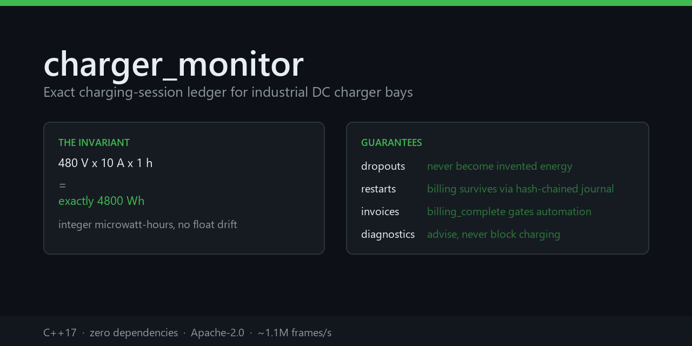

# charger_monitor

[](https://github.com/elmoutaouakiltarik-web/charger_monitor/actions/workflows/ci.yml)
[](LICENSE)
[](charger_project/CMakeLists.txt)
[](CONTRIBUTING.md)

Deterministic monitoring library for industrial DC charger bays.

It listens to a CAN bus, reconstructs an **exact** charging-session ledger,
persists it in a **durable, tamper-evident journal**, and rolls it up into
**fleet KPIs**. It never commands the power stage.

<p align="center">
  
</p>

> **This is not firmware.** Not a certified controller, not a safety function,
> not a legal or fiscal meter (MID). See [SECURITY.md](SECURITY.md) for the
> deliberate non-goals before you deploy anything.

## See it in 10 seconds

```bash
cmake -S charger_project -B build -DCHARGER_WERROR=ON
cmake --build build --parallel
./build/charger_demo
```

`charger_demo` walks a full shift and prints, as it happens: the exact energy
of an hour-long session, what happens to a session when the bus drops, why a
restart does not lose billing data, and what a tampered journal does.

## Why this exists

Most charger telemetry answers "what is the state right now" and then loses the
interesting part. The interesting part is: **what was delivered, what it is
worth, and can I prove it after the process restarts**.

This library treats the ledger as the product:

| Problem | Approach |
| --- | --- |
| Energy with floating-point drift | Trapezoidal integration in **microwatt-hours** with 128-bit integer arithmetic and a carried remainder. 480 V × 10 A × 1 h = exactly 4 800 Wh |
| A dropout silently billed as energy | Dropouts are never interpolated. They produce `MEASUREMENT_GAP`, and the session is flagged `energy_lower_bound` |
| A restart losing billing data | Append-only **hash-chained journal**, fsync on commit, replayed on startup. Sessions opened but never closed are reported as orphans and are **not billable** |
| Disputed invoices | `sha256_hex()` is exported and the line layout is documented, so any auditor can recompute the chain with standard tools |
| Guesswork about when to invoice | `billing_complete` is true only when the data is complete. Everything else is held for review |
| "Which bay earns?" | Fleet rollup across assets, rebuildable from a journal with no running process |
| Finding a failing connector before it fails | Predictive diagnostics that raise advisories and **never block charging** |

**Zero external dependencies.** Everything is the C++17 standard library. An
industrial operator has to audit what it ships, and a dependency tree is a
supply-chain liability.

## Quick start

```bash
cmake -S charger_project -B build -DCMAKE_BUILD_TYPE=Release -DCHARGER_WERROR=ON
cmake --build build --parallel
ctest --test-dir build --output-on-failure

# One hour at 480 V / 10 A priced at 0.25 EUR/kWh + 3.60 EUR/h + 0.50 EUR flat
./build/charger_monitor --replay --journal bay.journal --replay-interval-ms 1000 < frames.txt
./build/charger_monitor --verify-journal --journal bay.journal
./build/charger_settle bay.journal --summary
./build/charger_monitor --portfolio bay.journal
```

## The tools

Three small tools ship with the library. Each is also a downstream consumer, so
they double as a compile-time check that the public headers are self-contained.

| Tool | What it is for |
| --- | --- |
| [`charger_demo`](charger_project/tools/charger_demo) | Narrated walkthrough: cold start, session, dropout, diagnostics, crash recovery, fleet rollup |
| [`charger_settle`](charger_project/tools/charger_settle) | Billing settlement from a journal: a CSV of invoice-now vs held-for-review, with the reason each held session was held |
| [`charger_bench`](charger_project/tools/charger_bench) | Measures exactness against a double accumulator, and throughput |

`charger_bench` prints measured numbers, not claims:

```
            0.1 Wh x 1e6 (uWh)      100000000000      100000000001  DRIFTS by 1
     100k x 0.008333 EUR         833300000         833299999  DRIFTS by -1
        480 V*10 A*1 h (Wh)              4800              4800  EXACT
  throughput       1117142 frames/s
```

A 500 kbit/s CAN bus at 1 Hz delivers roughly 3 500 frames/s, so throughput is
not a constraint here. Exactness is.

## Use it as a library

```cmake
find_package(charger_monitor REQUIRED)
target_link_libraries(your_target PRIVATE charger::core)
```

A complete downstream project is in
[`examples/consume_library`](charger_project/examples/consume_library). CI builds
and runs it after installing the package, so the exported target cannot rot.

```cpp
#include <charger_monitor.hpp>

charger::Config cfg;
cfg.tariff.energy_micro_eur_per_kwh = 250000;   // 0.25 EUR, exact integers
charger::Monitor monitor(cfg);

const auto snapshot = monitor.snapshot();
if (snapshot.last_session && snapshot.last_session->billing_complete) {
    invoice(snapshot.last_session->total_cost_micro_eur);
}
```

Four independent headers, each usable on its own:

- `charger_monitor.hpp` — state machine, session ledger, tariff
- `charger_portfolio.hpp` — fleet rollup
- `charger_ledger.hpp` — durable journal, recovery, verification
- `charger_config.hpp` — versioned JSON configuration

## The billing contract

Energy is integrated only between consecutive accepted in-session samples. If
the interval exceeds `max_integration_step`, **no energy is added** and the
session is marked as a lower bound.

`billing_complete` is true only when the session closed cleanly, carried at
least two samples, had no integration gap and was not cut by a timeout.

| Field | Meaning |
| --- | --- |
| `energy_uwh` | Microwatt-hours integrated, as an integer string |
| `energy_wh` | Wh register, floored from uWh |
| `billed_energy_wh` | Energy after the OCPI `step_size` ceiling |
| `time_upper_bound` | True when charging was cut by a dropout: the billed time is an upper bound |
| `billing_complete` | The only field an automated invoice should trust |

Pricing follows an OCPI 2.2.1 subset: `ENERGY`, `TIME` and `FLAT`, with
`step_size` rounding and VAT omitted (which is **not** zero-rated VAT).
`PARKING_TIME` is deliberately **not** priced: this protocol cannot prove
connector occupancy while not charging, and inventing it would produce wrong
invoices.

## Deployment

```bash
charger_monitor can0 --config bay-07.json --journal /var/lib/charger/bay-07.journal
```

The JSON config is the base; CLI flags override it. A misspelled or malformed
field fails startup with its path rather than defaulting to zero, because a
silently-zero tariff invoices nothing and nobody notices.

On restart the journal is replayed: counters are restored, orphans are reported
on stderr, and a broken chain is surfaced instead of being ignored.

## Documentation

- [charger_project/README.md](charger_project/README.md) — CLI reference, demo protocol, diagnostics, schema fields
- [docs/INTEROP.md](docs/INTEROP.md) — field-by-field mapping to OCPP 2.0.1 and OCPI 2.2.1
- [CONTRIBUTING.md](CONTRIBUTING.md) — the five ground rules and the pre-merge checks
- [SECURITY.md](SECURITY.md) — deliberate non-goals and what counts as a vulnerability
- [CHANGELOG.md](CHANGELOG.md) — release history

## Interoperability

This library does not speak OCPP or OCPI, and does not need to. It produces the
exact local record; a backend maps it onto the standard vocabulary.
[docs/INTEROP.md](docs/INTEROP.md) maps every field, including `stoppedReason`,
the `Energy.Active.Import.Register` measurand and the `ENERGY`/`TIME`/`FLAT`
tariff dimensions, so nothing has to be reverse-engineered.

## Roadmap

Deliberately scoped. Anything here that would compromise exactness or the
zero-dependency property is not on the list.

- [x] Exact integer session ledger
- [x] Durable hash-chained journal with crash recovery
- [x] Fleet rollup and settlement report
- [x] Predictive diagnostics
- [x] Versioned JSON configuration
- [x] Consumable CMake package
- [ ] An optional OCPP 2.0.1 client behind a compile-time flag
- [ ] Multi-bay aggregation from a single journal process
- [ ] IEC 61851 / CCS signal decoding as a protocol profile
- [ ] A pluggable signed-CDR exporter (the chain is evidence, not a wire format)

## Verification

CI runs on every push:

| Job | What it proves |
| --- | --- |
| build (gcc + clang, `-Werror`) | No warnings under two compilers |
| sanitizers (ASan + UBSan) | No memory errors or undefined behaviour |
| coverage (gcovr) | Line and branch coverage of `src/` |
| fuzz (libFuzzer, 20 s) | No crash on malformed frames, tariffs or journal rows |
| end-to-end replay | The documented state sequence and ledger contract |
| journal tamper detection | A modified journal fails verification with a non-zero exit |
| tool smoke tests | The demo and settlement tools run and assert exact figures |
| consumable package | An external project can `find_package` and link it |
| clang-format | Formatting matches `.clang-format` |

## License

Apache-2.0. See [LICENSE](LICENSE).

Apache-2.0 rather than MIT because the patent grant is what unblocks adoption
in industrial products.