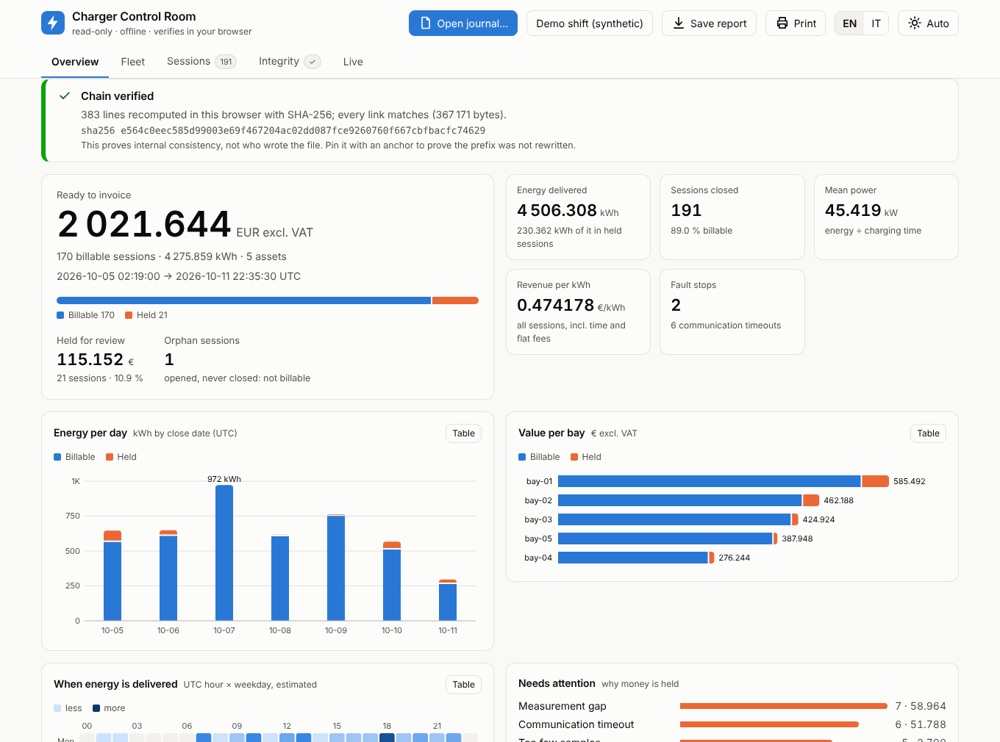
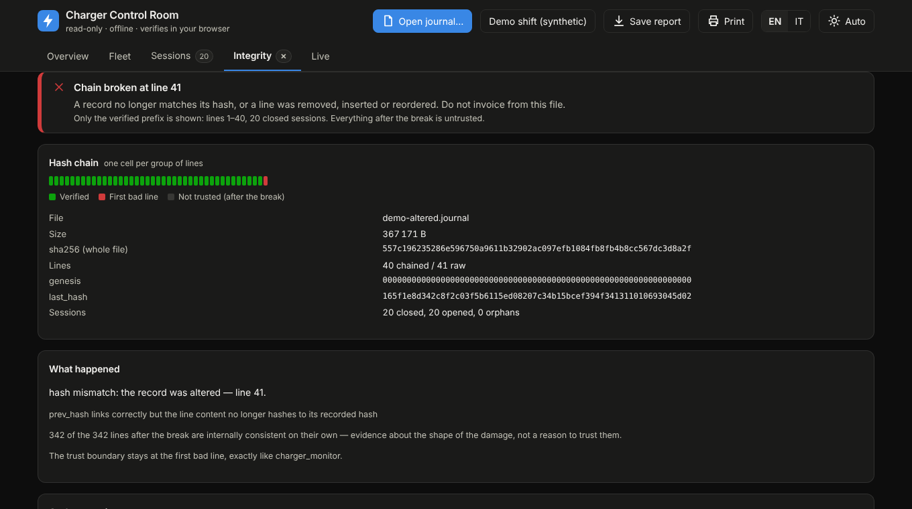
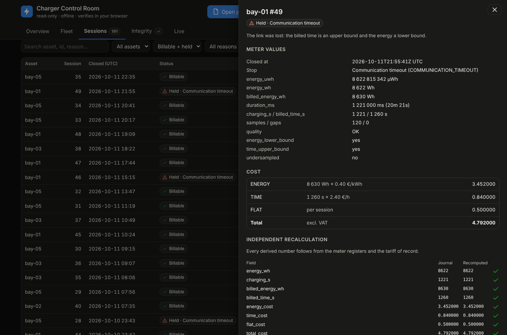
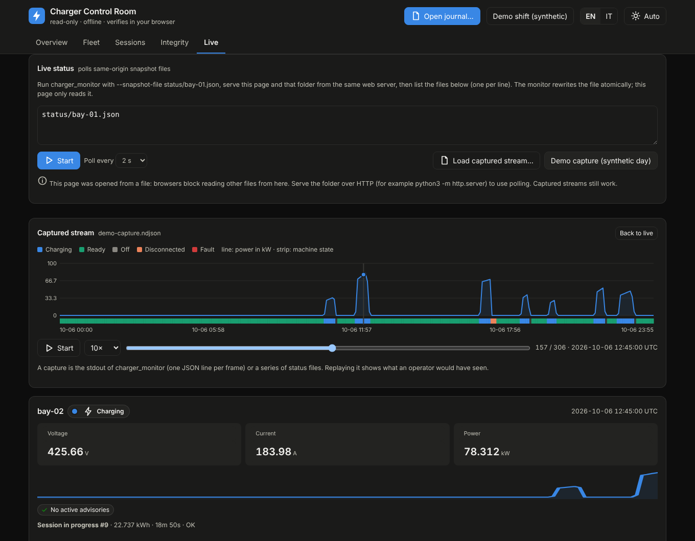
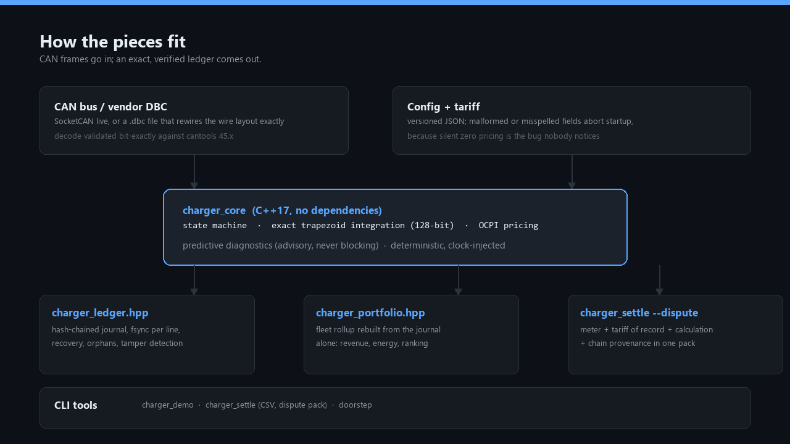
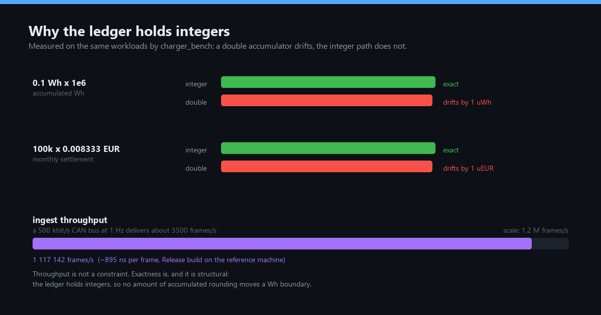
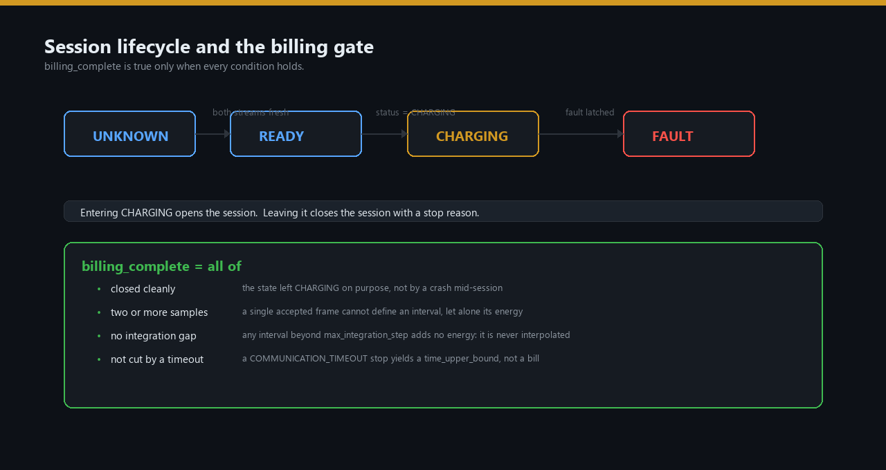

# charger_monitor

[](https://github.com/elmoutaouakiltarik-web/charger_monitor/releases/latest)
[](charger_project/CMakeLists.txt)
[](LICENSE)
[](sbom/charger_monitor.cdx.json)
[](docs/DASHBOARD.md)
[](SECURITY.md)
[](CONTRIBUTING.md)

**An independent, cabinet-side witness for industrial DC charger bays.**
It listens to the CAN bus, rebuilds an **arithmetically exact** record of every
charging session, writes it into a **tamper-evident journal**, and ships a
**read-only control room** that proves the whole thing in a browser — offline,
in one click, to anyone who doesn't trust you. It never commands the power stage.

<p align="center">
  <picture>
    <source media="(prefers-color-scheme: dark)" srcset="docs/dashboard-overview-dark.png">
    
  </picture>
</p>

<p align="center"><sub>The control room on a <b>synthetic</b> demo shift (5 bays, 7 days) produced by the real engine.
Dark and light themes, English and Italian, one HTML file.</sub></p>

> **What this is not.** Not firmware, not a certified controller, not a safety
> function, and not a measuring instrument under the MID or the German
> Eichrecht. Its figures are an operational record, arithmetically exact, whose
> accuracy is bounded by the sensors behind the CAN signals. See
> [docs/COMPLIANCE.md](docs/COMPLIANCE.md) and [SECURITY.md](SECURITY.md) for the
> deliberate non-goals before you deploy anything.

## See it in 60 seconds

**Nothing to install.** Download [`dashboard/charger-control-room.html`](dashboard/charger-control-room.html)
and open it in any modern browser (or use the hosted copy, once GitHub Pages serves
this repository's `/docs` folder: `https://elmoutaouakiltarik-web.github.io/charger_monitor/control-room.html`),
then press **Demo shift**. Then press **Demo with one altered
record** and watch the chain break at line 41, name the damage, and refuse to show
anything after it.

**Or build the engine:**

```bash
cmake -S charger_project -B build -DCMAKE_BUILD_TYPE=Release -DCHARGER_WERROR=ON
cmake --build build --parallel
./build/charger_demo          # a narrated shift: exact energy, a dropout, a crash, a tampered journal
./build/charger_synth --out demo.journal   # a reproducible multi-bay journal; open it in the control room
```

## The questions it answers

Most charger telemetry answers "what is the state right now" and then loses the
interesting part. The interesting part is **what was delivered, what it is
worth, and can I prove it after the process restarts — to someone hostile.**

| Question, asked by someone who doubts you | How it is answered |
| --- | --- |
| Is the energy right, or is it floating-point drift? | Trapezoidal integration in **microwatt-hours**, 128-bit integers, a carried remainder. 480 V × 10 A × 1 h is exactly 4 800 Wh on any machine, and `charger_bench` shows the `double` path drifting where this one does not |
| Was a communication dropout billed as energy? | Never. Dropouts are not interpolated: they produce `MEASUREMENT_GAP`, the session is flagged `energy_lower_bound`, and it is held for review |
| Did a restart lose the billing data? | Append-only **hash-chained journal**, fsync per line, replayed on start. A session open at a clean shutdown is closed as `INTERRUPTED` with its energy kept; after a crash it is reported as an orphan, **not billable** |
| Was this file edited after the dispute started? | The chain names the first altered line. An external **anchor** (optionally RFC 3161 time-stamped) proves a prefix was not rewritten after it was made |
| Why 5.30 EUR? | One click: the meter registers, the **tariff of record** embedded in that very close line, every derived number recalculated independently, and three shell lines an auditor can run with `sed`, `cut` and `sha256sum` |
| What may I invoice automatically? | Only `billing_complete`. Everything else is held *with the reason*: gap, timeout, too few samples, interruption, orphan |
| Is the certified meter drifting, or is our sensor chain? | `charger_settle --reconcile` compares the ledger with an independent meter, session by session, with a tolerance **you** set, and reports the systematic bias per bay |
| Which bay is quietly failing? | Predictive diagnostics (stuck sensor, voltage sag under load, current hunting) raise advisories and **never block charging**; Prometheus and the control room show them |
| Is the monitor itself still alive? | A status file with its own render time. A dead monitor looks exactly like a healthy one *unless something checks the file's age*, and both the dashboard and the example alert rules do |
| Can an auditor check it without trusting your binary? | Yes: the journal format is documented, the hash is standard, and the control room is a **second, independent implementation** tested byte for byte against the C++ tools |

## Who uses it for what

| You are | You get |
| --- | --- |
| **Charge-point operator / NOC** | Live bay status, Prometheus metrics and alert rules, held-session tracking, a hardened systemd unit — and no listening socket to patch |
| **Finance / billing** | Settlement CSV that separates *invoice now* from *held for review* with the reason, OCPI-style pricing with exact step rounding, TOU what-if, meter reconciliation |
| **Field engineer** | Replay a `candump -L` capture with its real timing, measure frame periods before choosing timeouts, adopt the vendor `.dbc` safely, diagnostics with thresholds from *your* data |
| **Auditor / dispute handler** | A dispute pack per session, an offline verifier, anchors, time-stamps, and a report file that re-verifies itself on the recipient's machine |
| **Integrator / OEM** | A CMake package (`charger::core`), no dependencies, an SBOM, a vulnerability policy, OCPP 2.0.1 and OCPI mappings written down field by field |

## The control room

One HTML file. No server, no framework, no CDN, no telemetry, **no way to write to
anything**. It reads a journal you drop on it (or status files you name), verifies
the SHA-256 chain **byte for byte in your browser**, and shows what an operator and
an auditor each need.

<p align="center">
  
</p>

- **Overview** — the verdict first; then *ready to invoice*, *held for review* and
  why, energy per day, value per bay, a heat map of when energy is delivered.
- **Fleet** — per-bay sessions, held share, energy, value, faults, timeouts and a
  daily sparkline, rebuilt from the journal alone.
- **Sessions** — filter, sort, export the settlement CSV; click a row for the
  evidence and the independent recalculation.
- **Integrity** — chain, digest, orphans, forensics on a broken journal, anchors
  created and verified (byte-compatible with the C++ tools).
- **Live** — state, V/I/P, advisories, session in progress and the *age of the
  status file*; replay a captured day with a state timeline.

<p align="center">
  
</p>

Dark mode, English/Italian, phone-width layouts, `Print`, and **Save report** (one
file with the journal embedded that re-verifies itself when opened). A
Content-Security-Policy pins the one script by its SHA-256 and allows no network
beyond its own origin; journal text reaches the page only as text. Details and the
security model: [docs/DASHBOARD.md](docs/DASHBOARD.md).

<p align="center">
  
</p>

## How it fits together

<p align="center">
  
</p>

**Zero external dependencies.** The library and every tool are the C++17 standard
library; the dashboard is a single file with no third-party code. An industrial
operator has to audit what it ships, and a dependency tree is a supply-chain
liability. ([SBOM](sbom/charger_monitor.cdx.json): zero components.)

### Where it fits, and where it does not

It is **not** a charge-point controller, an OCPP stack or a CSMS, and it does not
compete with them. It is the independent witness beside them: it keeps an exact
local record when the backend, the firmware or the uplink is missing or disputed.

| Project | What it does | What an exact, tamper-evident local session ledger adds |
| --- | --- | --- |
| [EVerest](https://github.com/EVerest/everest-core) (LF Energy, Apache-2.0) | Full charger stack: OCPP 1.6/2.0.1/2.1, ISO 15118, IEC 61851, drivers for power modules and meters; relays the **meter's** signed values | An independent record that is not in the control path, with an integer ledger, a local hash chain and anchors |
| [SteVe](https://github.com/steve-community/steve), [CitrineOS](https://github.com/citrineos/citrineos-core) | Central systems (CSMS) | They trust what the station reports; this is the cabinet's own witness |
| python [`ocpp`](https://github.com/mobilityhouse/ocpp) | OCPP message library | Metering and billing logic, which that library deliberately does not have |
| [cantools](https://github.com/cantools/cantools), [python-can](https://github.com/hardbyte/python-can) | DBC decoding, CAN transport | Session state, exact energy, the ledger. (This project's DBC reader is validated bit-exactly against cantools.) |
| OCMF + transparency software | Signed meter data from a certified meter | A second opinion on that meter: reconcile the two, never replace it |

It sits **below** OCPP/OCPI (backend side) and **beside** ISO 15118 / DIN SPEC 70121
(vehicle side, over PLC). It is a passive listener on the cabinet-internal CAN
segment described by the vendor DBC; CCS PLC frames never appear on that bus.

## Quick start

```bash
cmake -S charger_project -B build -DCMAKE_BUILD_TYPE=Release -DCHARGER_WERROR=ON
cmake --build build --parallel
ctest --test-dir build --output-on-failure

# One hour at 480 V / 10 A priced at 0.25 EUR/kWh + 3.60 EUR/h + 0.50 EUR flat
./build/charger_monitor --replay --journal bay.journal --replay-interval-ms 1000 < frames.txt
./build/charger_monitor --verify-journal --journal bay.journal
./build/charger_settle bay.journal --summary
./build/charger_monitor --portfolio bay.journal

# A real capture, with its real timing and recorded UTC
candump -L can0 > bay.log                       # on the cabinet
./build/charger_probe bay.log --config bay-07.json
./build/charger_monitor --replay-candump bay.log --config bay-07.json --journal bay.journal
```

## The tools

| Tool | What it is for |
| --- | --- |
| [`charger_monitor`](charger_project/src/main.cpp) | The monitor: live SocketCAN, `--simulate`, `--replay`, `--replay-candump`; journal, anchors, fleet roll-up, atomic status files (`--snapshot-file`, `--metrics-file`) |
| [`charger_settle`](charger_project/tools/charger_settle) | Settlement from a verified journal: CSV of *invoice now* vs *held*, `--dispute`, `--cdr`, `--ocpp`, `--reconcile`, `--tou-settle`, `--metrics` |
| [`charger_probe`](charger_project/tools/charger_probe) | Commissioning analyzer for a `candump` recording: per-id frame periods, longest silences — **facts, never suggested thresholds** |
| [`charger_demo`](charger_project/tools/charger_demo) | Narrated walkthrough: cold start, session, dropout, diagnostics, crash recovery, fleet rollup |
| [`charger_synth`](charger_project/tools/charger_synth) | A reproducible, **synthetic** multi-bay journal produced by the real engine, for demos, training and parity tests |
| [`charger_bench`](charger_project/tools/charger_bench) | Measures exactness against a double accumulator, and throughput |

```bash
# The dispute pack: everything needed to answer "why 5.30 EUR?"
./build/charger_settle bay.journal --dispute bay-07 12
# Pin the journal prefix into an external anchor (append-only storage), then date-certify it:
./build/charger_monitor --anchor-journal --journal bay.journal --anchor-file /mnt/worm/bay-07.anchor
./build/charger_monitor --verify-anchor  --journal bay.journal --anchor-file /mnt/worm/bay-07.anchor
scripts/notarise.sh request bay-07.anchor        # RFC 3161: only a 32-byte digest leaves the site
# A second opinion against the certified meter, with a tolerance YOU choose:
./build/charger_settle bay.journal --reconcile meter.csv --tolerance-ppm 5000
# Validate a windowed tariff, then estimate night-load shifting (labelled, never invoiced):
./build/charger_settle bay.journal --check-tou tou.json
./build/charger_settle bay.journal --tou-settle tou.json --summary
# A vendor fleet, adopted from the manufacturer's own CAN database:
./build/charger_monitor --replay < frames.txt --dbc vendor.dbc \
    --voltage-signal DC_Voltage --current-signal DC_Current
```

`charger_bench` prints measured numbers, not claims:

```
            0.1 Wh x 1e6 (uWh)      100000000000      100000000001  DRIFTS by 1
     100k x 0.008333 EUR         833300000         833299999  DRIFTS by -1
        480 V*10 A*1 h (Wh)              4800              4800  EXACT
```

The exactness rows are reproducible: any machine, any build, the integer path
agrees with the closed-form answer and the double path does not. The throughput
row is **not** — it depends on the machine and the build (a Release build here
ingests several million frames per second; a Debug build is several times slower).
Quote the ratio, not the figure. A 500 kbit/s CAN bus at 1 Hz delivers roughly
3 500 frames/s, so throughput is not a constraint. Exactness is.

<p align="center">
  
</p>

## Integrations that need no socket

The monitor opens **no listening socket**: a billing channel should not grow an
attack surface for the sake of a dashboard. It writes files atomically; whatever
already supervises your site reads them.

| Surface | Flag / tool | Read by |
| --- | --- | --- |
| JSON snapshot (the exact stdout envelope) | `--snapshot-file PATH` | the control room's Live view, any static web server |
| Prometheus text (node_exporter textfile collector) | `--metrics-file PATH`, `charger_settle --metrics` | Prometheus + [example alert rules](deploy/prometheus/charger-alerts.yml) |
| Settlement CSV | `charger_settle` | finance, spreadsheets (formula-safe in the dashboard export) |
| Dispute pack, CDR-input record, OCPP 2.0.1 `TransactionEvent` JSON | `--dispute`, `--cdr`, `--ocpp` | auditors, your backend ([field mapping](docs/INTEROP.md)) |
| Anchor + RFC 3161 time-stamp | `--anchor-journal`, `scripts/notarise.sh` | append-only storage, auditors |

A quantity the monitor cannot know is **omitted**, never exported as zero: absent
is the honest way to say "undefined" (`availability` with no in-service time is
`-1` in JSON and missing in Prometheus). Deployment, a hardened systemd unit,
nginx, alerting, rotation and backups: [docs/OPERATIONS.md](docs/OPERATIONS.md).

## Use it as a library

```cmake
find_package(charger_monitor REQUIRED)
target_link_libraries(your_target PRIVATE charger::core)
```

A complete downstream project is in
[`examples/consume_library`](charger_project/examples/consume_library). CI builds
and runs it after installing the package, so the exported target cannot rot.

```cpp
#include <charger_monitor.hpp>

charger::Config cfg;
cfg.tariff.energy_micro_eur_per_kwh = 250000;   // 0.25 EUR, exact integers
charger::Monitor monitor(cfg);

// The core is deterministic: pass the timestamp explicitly so replay and
// regression tests reproduce bit-for-bit without a wall clock.
const auto now = charger::Clock::now();
monitor.ingest(frame);
monitor.tick(now);
const auto snapshot = monitor.snapshot(now);
if (snapshot.last_session && snapshot.last_session->billing_complete) {
    invoice(snapshot.last_session->total_cost_micro_eur);
}
```

Independent headers, each usable on its own: `charger_monitor.hpp` (state machine,
session ledger, tariff), `charger_portfolio.hpp` (fleet rollup), `charger_ledger.hpp`
(journal, recovery, anchors, dispute and CDR), `charger_config.hpp` (versioned JSON
configuration), `charger_dbc.hpp` (vendor CAN database), `charger_tou.hpp`
(time-of-use windows), `charger_export.hpp` (Prometheus text, atomic file writes),
`charger_candump.hpp`, `charger_reconcile.hpp`, `charger_ocpp.hpp`.

## Session lifecycle and the billing gate

<p align="center">
  
</p>

## The billing contract

Energy is integrated only between consecutive accepted in-session samples. If
the interval exceeds `max_integration_step`, **no energy is added** and the
session is marked as a lower bound.

`billing_complete` is true only when the session closed cleanly, carried at
least two samples, had no integration gap, was not cut by a timeout and was not
interrupted by a monitor shutdown.

| Field | Meaning |
| --- | --- |
| `energy_uwh` | Microwatt-hours integrated, as an integer string |
| `energy_wh` | Wh register, floored from µWh |
| `billed_energy_wh` | Energy after the OCPI `step_size` ceiling |
| `time_upper_bound` | True when charging was cut by a dropout: the billed time is an upper bound |
| `energy_lower_bound` | True when part of the session was not measured |
| `quality` | `OK`, `NO_INTERVAL`, `GAPS`, `ZERO_ENERGY`, `INTERRUPTED`, `PRICE_OVERFLOW` |
| `billing_complete` | The only field an automated invoice should trust |

Pricing follows an OCPI 2.2.1 subset: `ENERGY`, `TIME` and `FLAT`, with
`step_size` rounding and VAT omitted (which is **not** zero-rated VAT).
`PARKING_TIME` is deliberately **not** priced: this protocol cannot prove
connector occupancy while not charging, and inventing it would produce wrong
invoices.

### What the journal proves, and what it does not

The hash chain proves **internal consistency**: no line was edited, inserted,
reordered or deleted without breaking the chain, and a third party can recompute
every link with `sed`, `cut` and `sha256sum` alone.

It does **not** prove authenticity. The chain is anchored to a public genesis
constant, so anyone who can rewrite the whole file can recompute it from scratch
and it will verify. `--anchor-journal` pins the prefix into a file you keep on
append-only storage, so a rewrite no longer survives; time-stamp that file
(RFC 3161) and you also know *when*. None of this is a signature, and none of it
is non-repudiation: that needs a key held outside this host.

## Deployment

```bash
charger_monitor can0 --config bay-07.json --journal /var/lib/charger/bay-07.journal \
    --snapshot-file /run/charger/status/bay-07.json
```

The JSON config is the base; CLI flags override it. A misspelled or malformed
field fails startup with its path rather than defaulting to zero, because a
silently-zero tariff invoices nothing and nobody notices. On restart the journal
is replayed: counters are restored, session ids continue, orphans are reported on
stderr, and a broken chain is surfaced instead of being ignored. A production
unit with a sandbox that cannot write outside its directories ships in
[`deploy/systemd`](deploy/systemd/charger-monitor@.service).

## Documentation

- [docs/DASHBOARD.md](docs/DASHBOARD.md) — the control room: views, live setup, report, security model, tests
- [docs/OPERATIONS.md](docs/OPERATIONS.md) — running a bay: listen-only CAN, systemd, nginx, Prometheus, journals, anchors, upgrades
- [docs/FIELD_GUIDE.md](docs/FIELD_GUIDE.md) — field guide for engineers and technicians: commissioning, acceptance test, dispute SOP, RFC 3161, TOU (in Italian)
- [docs/COMPLIANCE.md](docs/COMPLIANCE.md) — what it may and must not claim; MID, Eichrecht, AFIR, CRA, IEC 62443, with sources and confidence
- [docs/INTEROP.md](docs/INTEROP.md) — field-by-field mapping to OCPP 2.0.1/2.1 and OCPI 2.2.1/2.3.0
- [charger_project/README.md](charger_project/README.md) — CLI reference, demo protocol, diagnostics, schema fields
- [CONTRIBUTING.md](CONTRIBUTING.md) — the eight ground rules and the pre-merge checks
- [SECURITY.md](SECURITY.md) — deliberate non-goals, what counts as a vulnerability, SBOM
- [CHANGELOG.md](CHANGELOG.md) — release history

## Verification

Everything below runs in one command:

```bash
bash scripts/verify.sh build
```

It configures a `-Werror` Release build, runs the suite, and prints `PASS`,
`FAIL` or `SKIP` per step with counts at the end. A `SKIP` means a tool was
missing; it is never counted as a pass, and the summary says so.

What it covers, and how to run each piece yourself:

```bash
ctest --test-dir build --output-on-failure      # state machine, ledger, exports, synth, tools
bash charger_project/scripts/e2e_replay.sh      # state sequence, tamper detection, DBC, dispute, supervision files
bash charger_project/scripts/consume_test.sh    # a downstream find_package consumer
node --test dashboard/tests/core.test.mjs       # the independent verifier vs. the C++ tools, byte for byte
node --test dashboard/tests/ui.test.mjs         # browser tests (Playwright; skipped when absent)
python3 scripts/build_dashboard.py --check      # the committed bundle matches its sources
clang-format --dry-run --Werror charger_project/src/*.cpp charger_project/tests/*.cpp \
    charger_project/include/*.hpp charger_project/tools/*/main.cpp
```

GitHub Actions is configured for every push but may be disabled on an account
(billing); the same checks run locally. The workflow:

| Job | What it proves |
| --- | --- |
| build (gcc + clang, `-Werror`) | No warnings under two compilers; end-to-end replay; tamper detection; synthetic-journal determinism |
| sanitizers (ASan + UBSan) | No memory errors or undefined behaviour |
| coverage (gcovr) | Line and branch coverage of `src/` |
| fuzz (libFuzzer, 20 s) | No crash on malformed frames, tariffs, journal rows, candump lines |
| consumable package | An external project can `find_package` and link it |
| clang-format | Formatting matches `.clang-format` |
| dashboard | The bundle is current; the independent verifier agrees with the C++ tools |

Locally verified on GCC 13 and Clang under `-Werror`, with ASan + UBSan, and
(earlier releases) on GCC 16.1 MinGW and WSL2.

## Roadmap

Deliberately scoped. Anything here that would compromise exactness, the
zero-dependency property or the read-only boundary is not on the list.

- [x] Exact integer session ledger
- [x] Durable hash-chained journal with crash recovery and clean-shutdown closing
- [x] Fleet rollup and settlement report
- [x] Predictive diagnostics
- [x] Versioned JSON configuration, vendor DBC adoption
- [x] Consumable CMake package, SBOM
- [x] File-based TOU tariff with coverage validation and strict refusal on holes
- [x] External journal anchor, RFC 3161 time-stamping procedure
- [x] Read-only control room, atomic status files, Prometheus textfile metrics
- [x] `candump` replay with recorded time, commissioning probe
- [x] Meter reconciliation, OCPP 2.0.1 `TransactionEvent` export (file, no transport)
- [ ] An OCPI-conformant CDR export with operator-supplied party, token and location
- [ ] `signed_data` pass-through for OCMF from a certified meter (no signature verification: that stays with transparency software)
- [ ] Power-module CAN profiles from vendor DBCs (cabinet-internal bus)
- [ ] Multi-bay aggregation from a single process
- [ ] Chained anchors (`prev_anchor_sha256`) so deleting an anchor is detectable

## License

Apache-2.0. See [LICENSE](LICENSE).

Apache-2.0 rather than MIT because the patent grant is what unblocks adoption
in industrial products.
